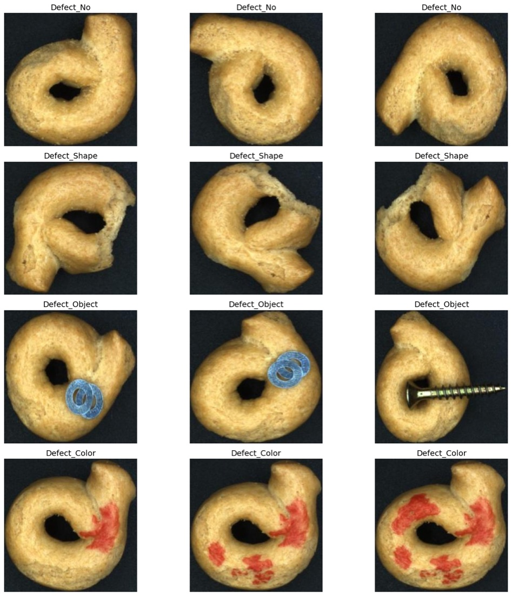
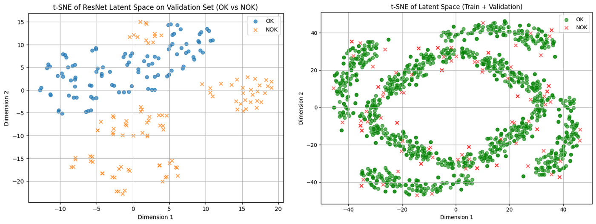
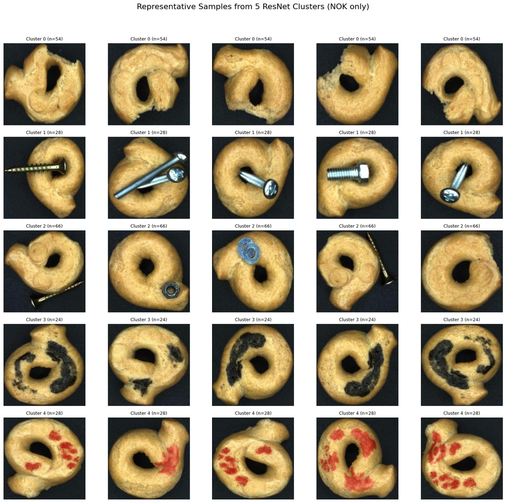
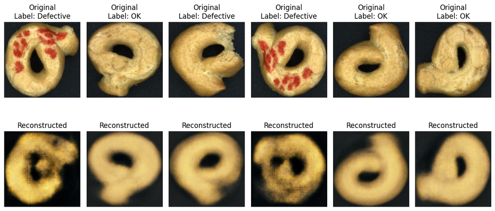
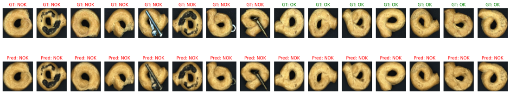
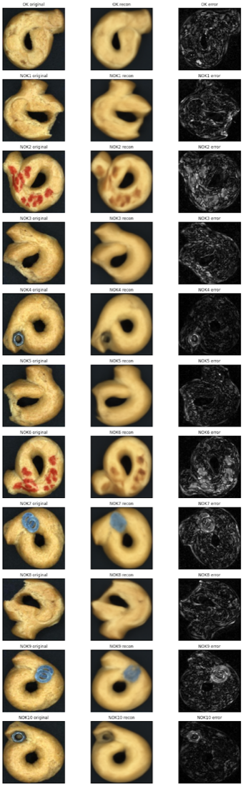
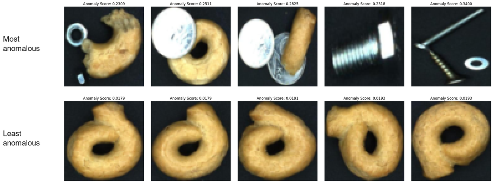
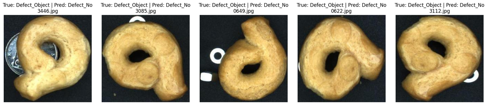

# Industrial Biscuit Defect Detection

Can a camera on a production line catch a broken biscuit, a red stain, or a screw baked
into the dough, ideally without anyone first labelling thousands of defects?

This project attacks the problem two ways:

- **Supervised classification** tells you *which* defect it is.
- **One-class anomaly detection** learns only what a good biscuit looks like and flags
  anything else.

The models compared range from a plain autoencoder to GANs, Vision-Transformer VAEs and
diffusion models.

<p align="center"></p>

The work was done in two phases:

- **Spring 2025:** reconstruction-based anomaly detection (Bayesian ML course).
- **Fall 2025:** supervised classification and feature-based anomaly detection (Computer Vision course).

## Data

The [Industry Biscuit dataset](https://www.kaggle.com/datasets/imonbilk/industry-biscuit-cookie-dataset/data)
has 1,225 Tarallini biscuits, each photographed at 4 rotations (4,900 images, 256 × 256).
The classes are 474 OK, 465 broken shape, 158 foreign object and 128 color defect.

<p align="center"></p>

Because each biscuit appears four times, splits must be made **per biscuit**. Otherwise a
rotated copy of a test biscuit sits in the training set.
[`prepare_data.py`](phase2_fall2025/00_data_prep/prepare_data.py) enforces this.

## How the anomaly score works

Every one-class model is trained on OK biscuits only and turns an image into a single
"how unusual is this?" number. The models differ in *where* that number comes from:

<p align="center"></p>

## Results

<p align="center"></p>

### 1. Pretrained features separate defects; a generative latent space doesn't

The left panel shows ResNet18 features of validation biscuits: OK and defective form
distinct regions, so a One-Class SVM fit on OK alone reaches **AUC 0.93**. The right panel
shows the ViT-VAE latent space, where defects are scattered among the normal biscuits.

<p align="center"></p>

Those same features organize the defects too. K-means on the defective biscuits' features,
with no labels involved, puts screws, bolts, washers, burns and red stains each in a group
of their own. (Clustering just the OCSVM's flags gives the same picture.)

<p align="center"></p>

### 2. For reconstruction models, a *worse* reconstruction is a better detector

The convolutional VAE is too blurry to redraw red stains, so stained biscuits come back with
a large error, which is exactly the signal you want:

<p align="center"></p>

The ViT-VAE, with a pretrained ViT-Base encoder, redraws screws, washers and burn marks
almost perfectly. The defect disappears from the error map, and test AUC drops to 0.61.

<p align="center"></p>

The DDPM diffusion model does the opposite: it "repairs" defects, fading red stains and
washers into the biscuit. The defects show up locally in the error map but barely move the
image-wide error (columns: original · reconstruction · error).

<p align="center"></p>

The DCGAN struck the best balance: sharp enough to keep fine detail, but unable to draw
what it never saw. It scored **F1 0.89** on the defective class.

<p align="center"></p>

### 3. Supervised classification

| Model | Test accuracy | Macro F1 |
|---|---|---|
| ResNet50V2 (fine-tuned) | ~100% | 1.00 |
| EfficientNet (fine-tuned) | ~99% | 0.99 |
| Basic CNN (Keras Tuner) | ~96% | 0.96 |
| Advanced CNN (BatchNorm + L2) | ~88% | 0.89 |

The misclassifications are informative: most are small washers or coins lying *beside* the
biscuit, which a classifier trained on whole-image appearance reads as OK.

<p align="center"></p>

## Takeaways

- **For a production line, start with pretrained features + a one-class model.** It needs
  no defect labels, gets AUC 0.93, adapts to a new product by refitting on fresh OK images,
  and its flags group naturally into defect types for root-cause analysis.
- **Reconstruction-based detection needs a model of limited capacity.** The stronger the
  generator (ViT-VAE, DDPM), the better it hides the anomaly.
- **Use supervised classification once defect types are known and labelled.** It's the
  right tool then, but evaluate it on a biscuit-level split and watch for small objects
  near the image border.

## Run it

```bash
pip install -r requirements.txt

# Unzip the Kaggle download to data/IndustryBiscuit (Images/ + Annotations.csv), then:
python phase2_fall2025/00_data_prep/prepare_data.py --raw data/IndustryBiscuit --out data/DS_multiclass --mode multiclass
python phase2_fall2025/00_data_prep/prepare_data.py --raw data/IndustryBiscuit --out data/DS --mode ok_nok
```

Notebooks read from `data/` by default. Set `BISCUIT_DATA_DIR` to point elsewhere, for
example a mounted Google Drive in Colab. A GPU is recommended for everything except the EDA.

```
phase1_spring2025/            Autoencoder, VAE (+ defect clustering), DCGAN, ViT-VAE
                              README.md there has the full Spring 2025 write-up
phase2_fall2025/
  00_data_prep/               prepare_data.py: biscuit-level splits
  01_eda/                     class balance, pixel statistics, resolution study
  02_supervised/              basic CNN, advanced CNN, transfer learning
  03_unsupervised/            ResNet18 + One-Class SVM, DDPM diffusion
docs/figures/                 figures and diagrams used above
```

## Team

- **Spring 2025:** Zimeng (Andy) Huang, [@mvemuri-22](https://github.com/mvemuri-22), [@alexlee0422](https://github.com/alexlee0422)
- **Fall 2025:** Andy Huang, Qi Qiao, Tracy Xu, Wen Yao

Phase 1 was first published at
[mvemuri-22/Industry-Biscuit-Anomaly-Detection](https://github.com/mvemuri-22/Industry-Biscuit-Anomaly-Detection);
its full commit history is preserved here.
